# homelab-k8s

> A production-style Kubernetes platform I built from bare metal on a repurposed laptop.

🇹🇷 [Türkçe README](README.tr.md) · 🐍 Application repo: [umuttvar/demo-app](https://github.com/umuttvar/demo-app)

**TL;DR:** A 3-node Kubernetes cluster built from bare metal, with a fully automated pipeline:
`git push` → tests → quality gate → image scan → GitOps deploy → monitoring → email alert.
No managed services: every layer configured and debugged by hand.

---

## How it works

```mermaid
flowchart LR
    dev["👨‍💻 git push"] --> app["demo-app repo<br/>code · Dockerfile · Jenkinsfile"]
    app -->|"pollSCM 5 min"| J

    subgraph J["Jenkins (ephemeral agent pod)"]
        direction LR
        t["Test<br/>pytest + coverage"] --> s["Quality gate<br/>SonarCloud"] --> b["Build<br/>Kaniko → tar"] --> v["Scan<br/>Trivy"] --> p["Push<br/>crane → GHCR"] --> g["Update GitOps<br/>tag: 1.0.N"]
    end

    g -->|"commit"| ops["homelab-k8s repo<br/>desired cluster state"]
    ops -->|"Argo CD polls 3 min"| argo["Argo CD"]
    argo -->|"rolling update"| pods["demo-app pods"]
    pods -->|"/metrics"| prom["Prometheus"] --> graf["Grafana"]
    prom --> am["Alertmanager"] --> mail["📧 Email"]
```

| | **demo-app** repo | **homelab-k8s** repo (this one) |
|---|---|---|
| Question it answers | *What* runs? | *How and where* does it run? |
| Contents | Source code, tests, Dockerfile, Jenkinsfile | Helm charts, Argo CD apps, platform config |
| Watched by | Jenkins | Argo CD |
| Output | A scanned container image | Running pods |

The only contract between the two repos is the **image tag**.

---

## Highlights

- **3-node vanilla Kubernetes** (kubeadm, not k3s) on Proxmox VMs cloned from one template
- **Zero-touch CI/CD:** tests → SonarCloud quality gate → Kaniko build → **Trivy scan before push** → GHCR → Argo CD
- **Pull-based GitOps for everything:** apps *and* platform (Traefik, MetalLB, Jenkins, monitoring, storage) are Argo CD Applications; Jenkins only writes to Git and has no access to the cluster
- **Everything as code:** apps, Grafana dashboards and alert rules all live in this repo
- **Metrics-driven fix:** found a misleading p95 (975 ms for a 500 ms endpoint), fixed it in code, shipped it through the pipeline, verified ~740 ms
- **32 real incidents** documented with root cause and fix

---

## At a glance

| Argo CD: App of Apps | Jenkins pipeline |
|---|---|
| 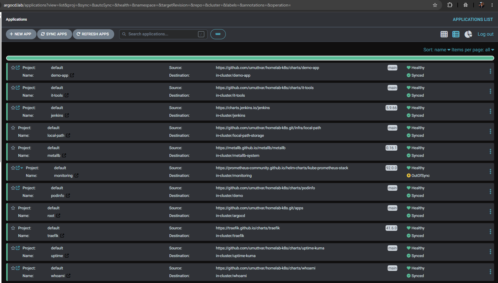 | 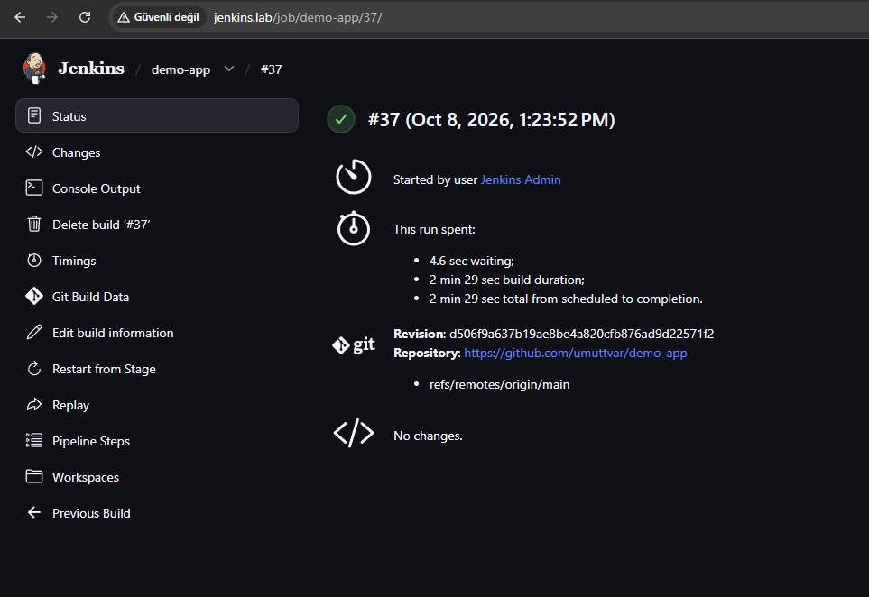 |
| **Grafana: golden signals** | **Alert in my inbox** |
| 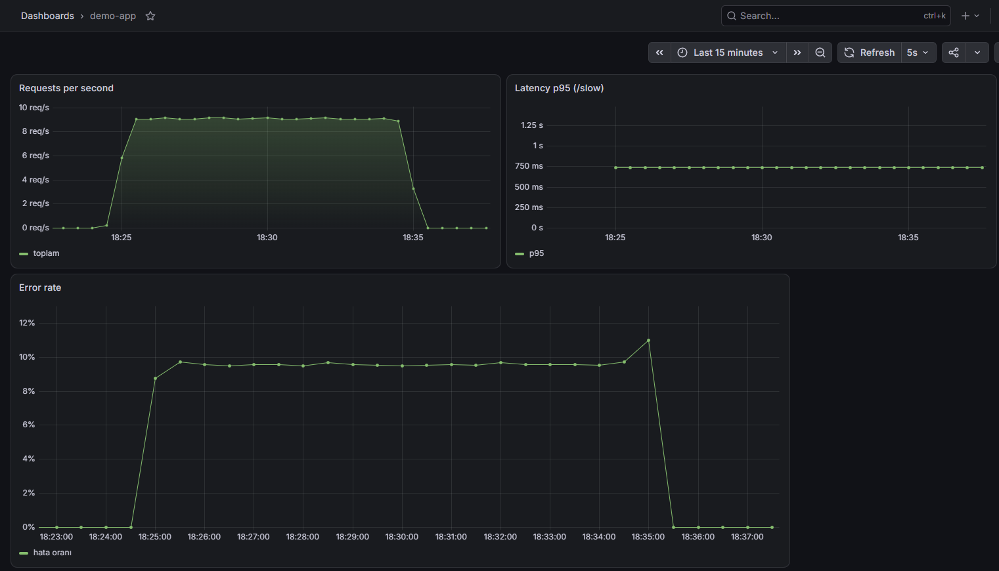 | 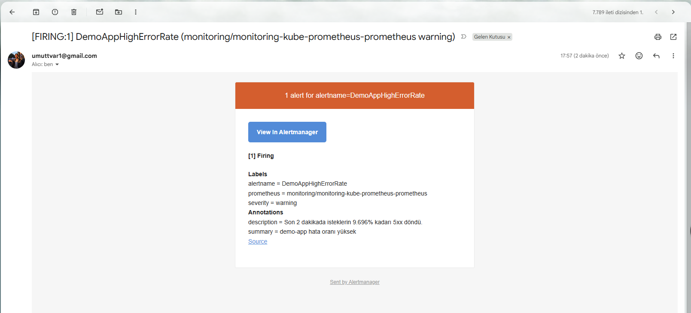 |

---

## Tech stack

| Layer | Tool | Notes |
|---|---|---|
| Hardware | Old laptop, 16 GB RAM | Repurposed as a 24/7 server, lid-close suspend disabled |
| Hypervisor | **Proxmox VE 9.2** | Type-1 (bare-metal) hypervisor, KVM/QEMU |
| Guest OS | **Ubuntu Server 26.04 LTS** | Cloned from a single prepared template |
| Container runtime | **containerd 2.2** | `SystemdCgroup = true` |
| Kubernetes | **v1.36.5 via kubeadm** | 1 control plane + 2 workers, vanilla (not k3s) |
| CNI | **Flannel** | Pod CIDR `10.244.0.0/16` |
| Package manager | **Helm 4** | Own charts + pinned third-party charts with values files |
| Load balancer | **MetalLB 0.16** (L2 mode) | FRR/BGP components disabled to save RAM |
| Ingress | **Traefik 3.7** | Chosen over ingress-nginx, which was retired in March 2026 |
| Storage | **local-path-provisioner** | Default StorageClass, dynamic PV provisioning |
| GitOps | **Argo CD 3.5** | App of Apps, automated sync with `prune` + `selfHeal` |
| CI | **Jenkins 2.580** on Kubernetes | Controller + ephemeral agent pods (6 containers) |
| Code quality | **SonarCloud** | CI-based analysis, pipeline waits for the quality gate |
| Image build | **Kaniko** | Daemonless, unprivileged builds inside Kubernetes |
| Image scan | **Trivy 0.75** | HIGH/CRITICAL, fixed CVEs only, blocks the pipeline |
| Registry | **GHCR** | Images pushed with `crane` |
| Monitoring | **kube-prometheus-stack** (Prometheus, Grafana, Alertmanager) | ServiceMonitor, PrometheusRule, dashboards as code |
| Uptime checks | **Uptime Kuma** | Checks via in-cluster Service DNS |
| Application | **FastAPI** (Python 3.13) | `/`, `/health`, `/slow`, `/error`, `/metrics` |

---

## Roadmap

- [x] Proxmox hypervisor on bare metal
- [x] 3-node kubeadm cluster from a VM template
- [x] MetalLB + Traefik + local-path storage
- [x] Self-written Helm charts for 5 applications
- [x] GitOps with Argo CD (App of Apps, prune + self-heal)
- [x] CI with Jenkins: test → SonarCloud → Kaniko → Trivy → GHCR → GitOps commit
- [x] Prometheus + Grafana monitoring, dashboards as code
- [x] Alerting: PrometheusRule → Alertmanager → email
- [x] Platform components (`infra/`) managed by Argo CD too, migrated with zero downtime
- [ ] TLS with cert-manager
- [ ] Sealed Secrets
- [ ] Rebuild everything with Terraform (Proxmox provider) + Ansible

---

## Deep dive

Click a section to expand it.

<details>
<summary><b>Why this project?</b></summary>

I wanted hands-on experience with the things cloud providers normally hide from you.
On AWS or Azure you get a load balancer IP, an ingress endpoint, a CI runner and a
monitoring stack "for free". In this homelab **there was nothing**: every layer had to be built,
configured and debugged by hand, from BIOS settings up to the alert that lands in my inbox.

</details>

<details>
<summary><b>Architecture &amp; network plan</b></summary>

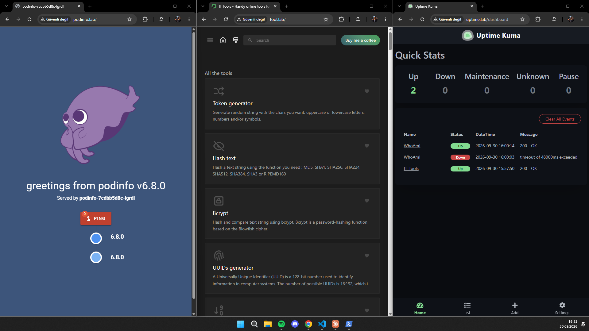

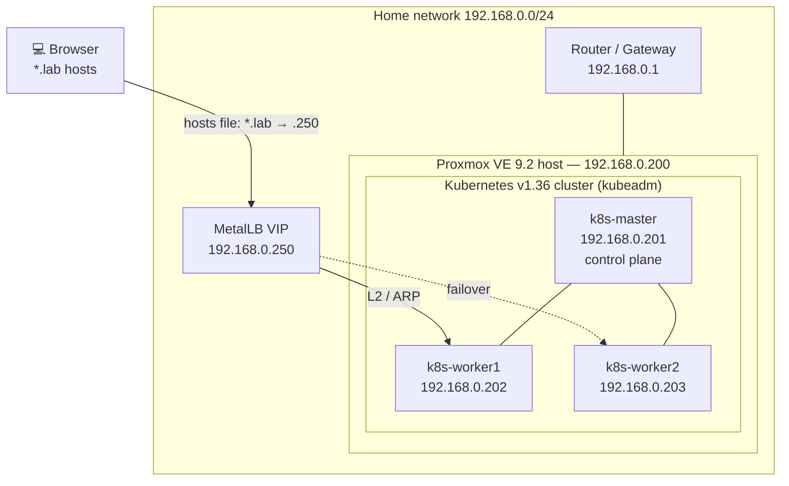

### Request flow

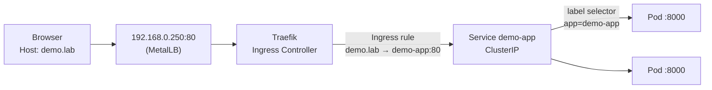

One IP, one port, many applications: Traefik routes each request by its HTTP `Host` header.

### Network plan

| Address | Purpose |
|---|---|
| `192.168.0.1` | Router / default gateway |
| `192.168.0.2 – .249` | Router DHCP pool (other home devices) |
| `192.168.0.200` | Proxmox VE host |
| `192.168.0.201` | `k8s-master` (static) |
| `192.168.0.202` | `k8s-worker1` (static) |
| `192.168.0.203` | `k8s-worker2` (static) |
| `192.168.0.250 – .254` | MetalLB LoadBalancer pool (outside DHCP range) |
| `10.244.0.0/16` | Pod network (Flannel) |
| `10.96.0.0/12` | Service network (Kubernetes default) |

</details>

<details>
<summary><b>Repository structure</b></summary>

```
homelab-k8s/
├── root-app.yaml               # Argo CD "App of Apps": the only thing applied by hand
├── apps/                       # One Argo CD Application per component
│   ├── demo-app.yaml           # ┐
│   ├── podinfo.yaml            # │ my own charts (charts/)
│   ├── whoami.yaml             # │
│   ├── it-tools.yaml           # │
│   ├── uptime-kuma.yaml        # ┘
│   ├── traefik.yaml            # ┐
│   ├── metallb.yaml            # │ platform: upstream chart (pinned)
│   ├── jenkins.yaml            # │ + values from infra/
│   ├── monitoring.yaml         # │
│   └── local-path.yaml         # ┘
├── charts/                     # Helm charts I wrote myself
│   ├── demo-app/               # The app built by the CI pipeline
│   │   ├── values.yaml         # image.tag is bumped by Jenkins on every build
│   │   ├── dashboards/
│   │   │   └── demo-app.json   # Grafana dashboard (exported, classic JSON)
│   │   └── templates/
│   │       ├── deployment.yaml
│   │       ├── service.yaml
│   │       ├── ingress.yaml
│   │       ├── servicemonitor.yaml      # "Prometheus, scrape me"
│   │       ├── prometheusrule.yaml      # Alert rules
│   │       └── dashboard-configmap.yaml # Picked up by the Grafana sidecar
│   ├── podinfo/                # Rolling update / rollback experiments
│   ├── whoami/                 # Stateless app, 3 replicas
│   ├── it-tools/               # Stateless SPA, 3 replicas
│   └── uptime-kuma/            # Stateful app: PVC, single replica, Recreate strategy
├── infra/                      # Values / manifests for platform components (used by apps/)
│   ├── metallb/
│   ├── traefik/
│   ├── local-path/
│   ├── argocd/
│   ├── jenkins/
│   └── monitoring/             # kube-prometheus-stack: ingress, retention, alert routing
└── docs/images/                # Screenshots used in this README
```

> Everything under `apps/`, `charts/` and `infra/` is reconciled by Argo CD: a push is a deploy.
> The only exception is Argo CD itself (`infra/argocd/`), installed once with Helm as the bootstrap step.

</details>

<details>
<summary><b>How it was built: 11 phases, from BIOS to a fully GitOps-managed platform</b></summary>

### Phase 0 — Turning a laptop into a hypervisor

- Verified CPU virtualization (VT-x) was enabled in BIOS.
- Installed **Proxmox VE** from USB, replacing Windows.
- Disabled suspend on lid close with a systemd-logind drop-in
  (`/etc/systemd/logind.conf.d/lid.conf`), since Debian 13 no longer ships `/etc/systemd/logind.conf`.
- Switched from the enterprise to the no-subscription update repository and upgraded the host.

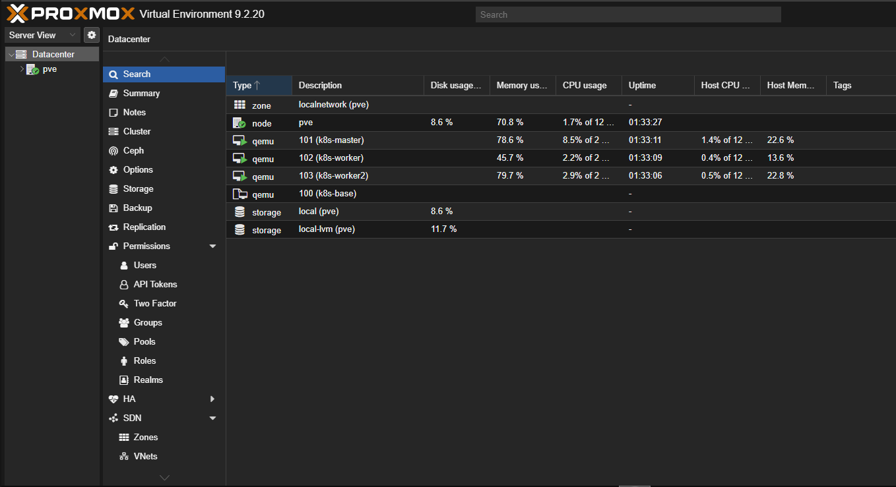

### Phase 1 — A reusable VM template

Instead of installing Ubuntu three times, I prepared **one** VM and cloned it:

1. Installed Ubuntu Server with OpenSSH and `qemu-guest-agent`.
2. Applied everything every Kubernetes node needs:
   - swap disabled permanently (`swapoff -a` + `/etc/fstab`)
   - kernel modules `overlay`, `br_netfilter` and the required `sysctl` settings
   - containerd with `SystemdCgroup = true`
   - `kubeadm`, `kubelet`, `kubectl` from `pkgs.k8s.io`, pinned with `apt-mark hold`
3. Reset `/etc/machine-id` so each clone gets a unique identity (otherwise the router hands all clones the same DHCP lease).
4. Converted it to a **Proxmox template** and created three **full clones**.
5. Gave each clone its own hostname, static IP (netplan) and `/etc/hosts` entries.

### Phase 2 — Bootstrapping the cluster

```bash
# on k8s-master
sudo kubeadm init \
  --apiserver-advertise-address=192.168.0.201 \
  --pod-network-cidr=10.244.0.0/16

kubectl apply -f https://github.com/flannel-io/flannel/releases/latest/download/kube-flannel.yml

# on each worker
sudo kubeadm join 192.168.0.201:6443 --token <token> --discovery-token-ca-cert-hash sha256:<hash>
```


### Phase 3 — Deployments, Services, rolling updates

Deployed the first application with hand-written manifests to understand the building blocks:

- **Labels & selectors** tying Deployment → Pods ← Service together
- **Readiness vs. liveness probes**
- **Resource requests & limits**
- **The three ports** of a Service: `nodePort` (outside), `port` (inside the cluster), `targetPort` (the container)
- **Rolling update** to a new image version while a loop of `curl` requests confirmed zero downtime
- **Rollback** of a deliberately broken release (`ImagePullBackOff`); `maxUnavailable: 0` kept the old version serving traffic the whole time
- **Configuration drift**: why `kubectl rollout undo` must be followed by fixing the manifest in Git

### Phase 4 — Turning the cluster into a platform

| Problem | Solution |
|---|---|
| `type: LoadBalancer` stays `<pending>` forever | **MetalLB** hands out real IPs from the home network (L2/ARP) |
| One NodePort per app (`:30080`, `:30081` ...) | **Traefik** + Ingress rules: one IP, routing by host name |
| Data disappears when a Pod restarts | **local-path-provisioner** as the default StorageClass |

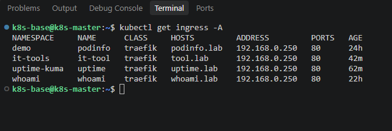

### Phase 5 — Writing my own Helm charts

I converted the raw manifests into a Helm chart (`values.yaml` + templated `templates/`),
then used it as a starting point for new applications, reading each image's documentation
to find its port, data directory and health endpoint:

| App | URL | Replicas | Storage | Notes |
|---|---|---|---|---|
| demo-app | `http://demo.lab` | 2 | – | Built and deployed by the CI/CD pipeline |
| podinfo | `http://podinfo.lab` | 2 | – | Rolling update / rollback lab |
| whoami | `http://whoami.lab` | 3 | – | Visualizes load balancing across Pods |
| IT-Tools | `http://tool.lab` | 3 | – | Pinned image tag instead of `latest` |
| Uptime Kuma | `http://uptime.lab` | **1** | **1 Gi PVC** | SQLite → single replica + `Recreate` strategy |

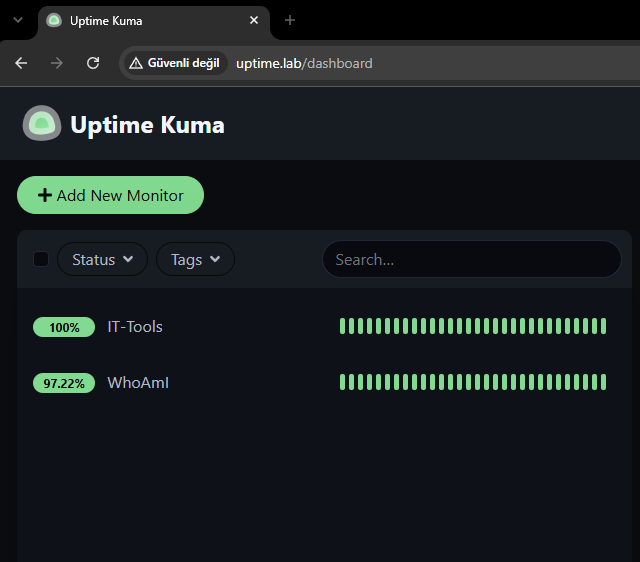

### Phase 6 — GitOps with Argo CD

This repository became the **single source of truth** for the cluster.

- **App of Apps:** `root-app.yaml` points Argo CD to `apps/`; every file there is an Application pointing to a chart in `charts/`. Adding an app = adding one file.
- **Automated sync** with `prune: true` (removed from Git → removed from the cluster) and `selfHeal: true` (manual changes in the cluster are reverted).
- **Adopting existing releases:** the apps were already installed with Helm. I deleted only the Helm release secrets (`sh.helm.release.v1.*`) so Argo CD could take ownership without recreating the resources.
- **Rollback = `git revert`.** A `kubectl rollout undo` would be reverted by `selfHeal` anyway; Git history is the audit log.

Self-heal test: `kubectl delete configmap demo-app-dashboard` → Argo CD recreated it within seconds → the Grafana dashboard came back on its own.


### Phase 7 — CI with Jenkins

Jenkins runs **on the cluster**. Each build gets a fresh **agent pod** with one container per tool
(python, sonar-scanner, kaniko, trivy, crane, git). The pod is deleted when the build ends: clean environment every time,
resources only used while building.

| Stage | Tool | Why it's there |
|---|---|---|
| Test | `pytest --cov` | Cheapest gate first; produces `coverage.xml` |
| Code Quality | SonarCloud | `sonar.qualitygate.wait=true` makes the gate **blocking**, not just a report |
| Build | Kaniko `--no-push` | No Docker daemon, no privileged container. The image is written to `image.tar` only |
| Security Scan | Trivy `--severity HIGH,CRITICAL --ignore-unfixed --exit-code 1` | **Shift-left:** a vulnerable image never reaches the registry |
| Push | crane | Pushes the already scanned tar to GHCR as `1.0.<BUILD_NUMBER>` |
| Update GitOps | git | Commits the new tag to `charts/demo-app/values.yaml` in this repo |

Pipeline options: `timeout(20 min)`, `disableConcurrentBuilds()`, and memory requests/limits on every agent container.

**The Trivy story:** the first scan failed on HIGH CVEs that were not in my code at all. They came from libraries
vendored inside `pip` itself, which was sitting in the runtime image for no reason. The fix was not a patch but
**removing what isn't needed** (`pip uninstall -y pip` after installing dependencies): a smaller attack surface.


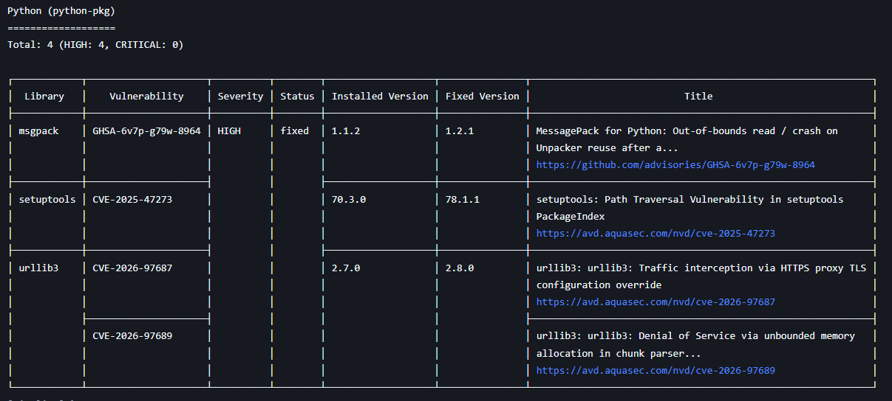
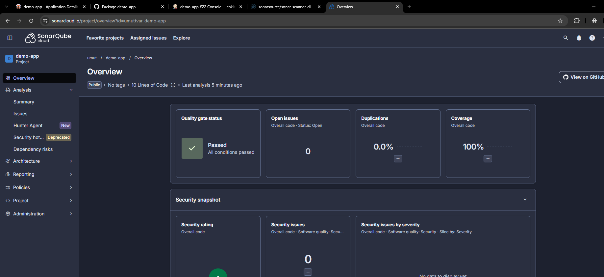
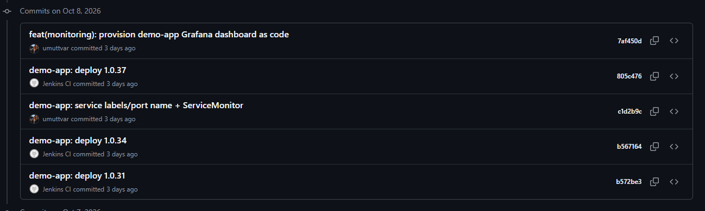

#### Secrets: one token per job, least privilege

| Credential | Scope | Stored as |
|---|---|---|
| `ghcr-creds` | GitHub token with `write:packages` only | Kubernetes Secret in the `jenkins` namespace, mounted into the crane container |
| `github-gitops` | Fine-grained token: **only** `homelab-k8s`, **only** Contents read/write | Jenkins credential |
| `sonarcloud-token` | SonarCloud analysis token | Jenkins credential (Secret text) |
| `gmail-smtp` | Gmail **app password** (not the account password), revocable | Kubernetes Secret in `monitoring`, mounted into Alertmanager |

None of them are in Git, even though both repositories are public. Jenkins has **no** kubeconfig and no cluster permissions.

### Phase 8 — Monitoring with Prometheus & Grafana

Installed **kube-prometheus-stack** (Prometheus Operator, Prometheus, Grafana, Alertmanager, node-exporter, kube-state-metrics) with 3-day retention and a 5 Gi volume.

**How the app gets scraped:**

```
FastAPI + prometheus-fastapi-instrumentator  →  exposes /metrics
ServiceMonitor (in the demo-app chart)       →  "scrape Services labeled app=demo-app, port 'http', path /metrics, every 15s"
Prometheus Operator                          →  turns it into Prometheus config
Kubernetes Endpoints                         →  current Ready pod IPs; Prometheus scrapes each pod directly
```

Pods are scraped individually, not through the Service: going through the load balancer would mix the counters of different pods.

**Dashboard** with the golden signals, built with PromQL:

| Panel | Query |
|---|---|
| Requests/s | `sum(rate(http_requests_total{namespace="demo-app", handler="/"}[1m]))` |
| Error rate | `sum(rate(...{status="5xx"}[1m])) / sum(rate(...[1m]))` |
| p95 latency | `histogram_quantile(0.95, sum by (le) (rate(http_request_duration_seconds_bucket{handler="/slow"}[5m])))` |

**Dashboards as code:** the dashboard is exported as classic JSON into `charts/demo-app/dashboards/` and wrapped in a
ConfigMap labeled `grafana_dashboard: "1"`. Grafana's sidecar loads it automatically. It is now versioned in Git and
marked as provisioned in the UI.

**Load test:** 20 concurrent clients (`xargs -P 20 curl`) peaked at **~280 requests/s** on two pods.

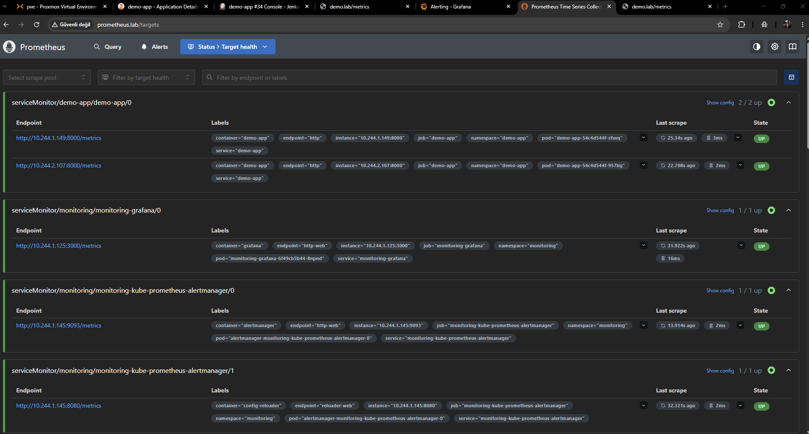


#### Observability-driven fix: the p95 that lied

`/slow` sleeps for 0.5 s, but the p95 panel showed **975 ms**.

- The instrumentator's default buckets are only `0.1, 0.5, 1`. A 0.502 s request misses the `0.5` bucket by a hair and lands in `0.5–1`.
- `histogram_quantile` assumes values are spread evenly inside a bucket, so p95 = 0.5 + 0.95 × 0.5 = **0.975 s**.
- **Fix in code:** `latency_lowr_buckets=(0.05, 0.1, 0.25, 0.5, 0.75, 1, 2.5)`.
- Pushed to `demo-app` → Jenkins → GHCR → Argo CD → new pods → the panel dropped to **~740 ms** (0.5 + 0.95 × 0.25), exactly as predicted.

Lesson: a histogram is only as precise as its buckets. Bucket boundaries should sit on the thresholds you care about (your SLOs).
More buckets per handler means more time series (cardinality), which is why the library keeps a separate high-resolution histogram without the `handler` label.

### Phase 9 — Alerting

**Rule as code** (`charts/demo-app/templates/prometheusrule.yaml`):

```yaml
- alert: DemoAppHighErrorRate
  expr: |
    sum(rate(http_requests_total{namespace="demo-app", status="5xx"}[2m]))
    /
    sum(rate(http_requests_total{namespace="demo-app"}[2m]))
    > 0.05
  for: 2m
  labels:
    severity: warning
```

- The rule carries `release: monitoring`, because the operator's `ruleSelector` only loads rules with that label.
- `for: 2m` keeps the alert **pending** first, so a short spike doesn't wake anyone up.
- The annotation uses `` {{` ... `}} `` so Helm passes `{{ $value | humanizePercentage }}` through untouched to Prometheus.

**Routing:** Alertmanager groups alerts by `alertname` + `namespace`, sends them by **email** (Gmail SMTP with an app password
read from a mounted Secret), sends a **resolved** message when the problem ends, and routes `Watchdog` to a null receiver.

Tested end to end: generated ~10 % errors → inactive → pending → firing → email → stopped traffic → resolved email.

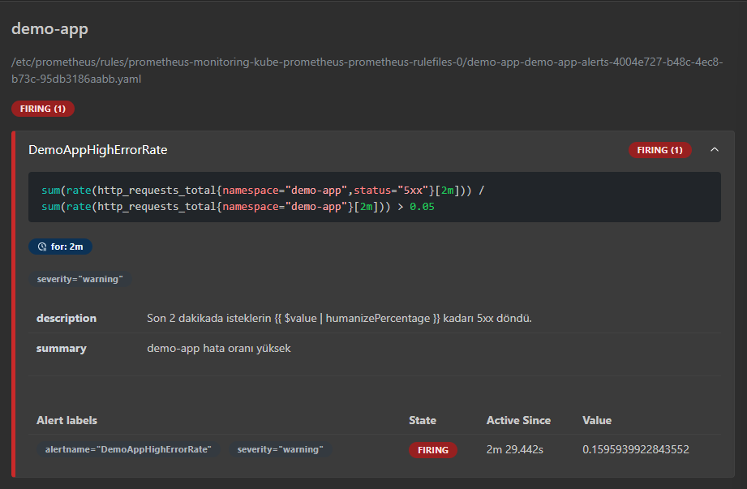


### Phase 10 — Moving the platform itself to GitOps

Traefik, MetalLB, Jenkins, kube-prometheus-stack and local-path were installed with `helm`/`kubectl` before Argo CD existed.
I migrated each of them to an Argo CD Application, **without downtime and without data loss**:

- **Multi-source Applications:** the chart comes from the upstream Helm repo (pinned version), the values from this repo
  (`ref: values` + `$values/infra/<tool>/values.yaml`). MetalLB has a third source that applies only `config.yaml`
  from the same folder (`directory.include`).
- **`helm.releaseName` = the original release name**, so the rendered resource names match the running ones.
- **Adoption procedure, one tool at a time:** no automated sync → review the App Diff (expected: only the
  `argocd.argoproj.io/tracking-id` annotation) → manual sync → delete the Helm release record
  (`owner=helm` Secret, **not** `helm uninstall`) → enable automated sync.
- **kube-prometheus-stack needs `ServerSideApply=true`:** its CRDs are too large for the `last-applied` annotation.
- **Two hidden problems surfaced** (see *Problems I hit → GitOps migration*): a default StorageClass set by a manual
  `kubectl patch` that was never in Git, and a Grafana admin password regenerated on every render.

Result: `helm list -A` shows only `argocd`. Every other change, platform or application, goes through Git.
Argo CD itself stays the single bootstrap step, deliberately not self-managed.


</details>

<details>
<summary><b>Design decisions</b></summary>

- **Vanilla Kubernetes (kubeadm) instead of k3s:** closer to what companies run and to the CKA exam; nothing is hidden.
- **Traefik instead of ingress-nginx:** ingress-nginx reached end of life in March 2026; Traefik supports both Ingress and Gateway API.
- **MetalLB pool outside the DHCP range:** prevents the router from handing a Service IP to a phone.
- **Two repositories, one contract (the image tag):** application code and cluster state change for different reasons and at different speeds.
- **Pull-based GitOps:** CI writes to Git, Argo CD pulls. A compromised Jenkins can't touch the cluster directly.
- **Scan before push:** Trivy runs on the local tar; the registry only ever contains scanned images.
- **Kaniko instead of Docker-in-Docker:** no daemon, no privileged pods.
- **Immutable, unique tags (`1.0.<build>`)**, never `latest`: every deployment is traceable to a build and a commit.
- **Pinned chart versions** (`helm upgrade --version ...`): an unpinned upgrade silently pulls the newest chart.
- **Memory limits on every container, no CPU limits:** memory can't be shared when a node runs out; CPU limits mainly cause throttling.
- **Stateful app = 1 replica + `Recreate`:** two Pods must never open the same SQLite file. Trade-off: a short downtime on restarts, in exchange for data integrity.
- **Dashboards and alerts live next to the app** (in its chart): they are deployed, versioned and rolled back together with it.
- **Values files in Git instead of `helm --set`:** `--set` silently creates drift between the repository and the cluster.
- **Argo CD is the only bootstrap step and is not self-managed:** if a self-managed Argo CD breaks itself during an upgrade, the tool that would fix it is the one that's broken. In production, Terraform would install it.
- **Secrets the chart would generate are provided instead** (`existingSecret`): random values generated with Helm's `lookup` don't survive Argo CD's offline rendering.
- **Uptime Kuma checks Services through cluster DNS** (`<svc>.<ns>.svc.cluster.local`): `*.lab` names only exist in my workstation's hosts file.

</details>

<details>
<summary><b>Problems I hit: 32 real incidents, root cause and fix</b></summary>

Real troubleshooting, in the order it happened.

### Platform

| Symptom | Root cause | Fix |
|---|---|---|
| Proxmox web UI unreachable | Host IP set to `192.168.1.x`, router on `192.168.0.x`: different subnets | Re-addressed `/etc/network/interfaces` to `192.168.0.200/24` |
| `sed: can't read /etc/systemd/logind.conf` | Debian 13 no longer ships the file | Used a drop-in in `logind.conf.d/` |
| `kubeadm init`: `[ERROR Mem] ... 1642 MB` | VMs created with the default 2 GB RAM | Raised all nodes to 4 GB |
| Workers stuck at `Waiting for a healthy kubelet` | Swap was still on: the `fstab` line used tabs, my `sed` pattern expected spaces | Commented the swap line with a whitespace-agnostic pattern, `kubeadm reset`, re-join |
| MetalLB installed 5-container `frr-k8s` pods | New chart versions enable the BGP backend by default | Found `frrk8s.enabled` via `helm show values`, disabled it in a values file |
| `strict decoding error: unknown field` | Typos in field names (`ipAdressPools`, `accessMode`, `mounthPath`) | Read the error: Kubernetes names the exact field |
| Ingress not created, no error | `ingress.yaml` placed next to `templates/` instead of inside it | Helm only renders files inside `templates/` |
| `volumes` rejected / probes lost | `volumes:` indented inside the container block | Moved it to the Pod spec level, sibling of `containers:` |
| `/health` probe passing on an app without a health endpoint | SPA returns `index.html` (200) for every path | Changed the probe to `/` so the intent is explicit |
| Host and VMs dropping off the network every few hours | Realtek `r8169` NIC link flaps (`Link is Down`), triggered by Energy-Efficient Ethernet | New cable/port, `ethtool --set-eee nic0 eee off` as a `post-up` hook on `vmbr0` |
| `worker2` **NotReady**, mass pod evictions | Heavy pods pinned to it by local-path PVs (Jenkins, Prometheus, Uptime Kuma) plus a 6-container build pod with **no requests**, so the scheduler thought it was free | Added requests/limits to every agent container; learned that node-local storage pins pods to nodes |
| Pods `Pending`, node `DiskPressure` | The Ubuntu installer allocated only 15 of 30 GB to the root LV | `lvextend -r -l +100%FREE` on every node, online, no reboot |
| A stale `failed` release `monitoring` in `default` | An earlier install without `-n monitoring` | Removed only its Helm release record and namespaced leftovers, **not** `helm uninstall`, which could have deleted cluster-scoped RBAC shared with the working release |

### CI/CD

| Symptom | Root cause | Fix |
|---|---|---|
| SonarCloud `403` | I had passed the **project key** as the token | Generated a real analysis token, stored it as a Jenkins secret |
| Kaniko: `UNAUTHORIZED` from Docker Hub | Not an auth problem: the `FROM` line was missing the `python:` image name | Read the full image reference in the error |
| Trivy fails on HIGH CVEs | Libraries vendored inside `pip` in the runtime image | `pip uninstall -y pip` in the Dockerfile |
| `git push` rejected | Jenkins had committed a new tag in the meantime | `git pull --rebase` before every push (commit or stash first) |
| Jenkins stuck in `Init:CrashLoopBackOff` / `Unknown` after **every host reboot** | The init container's `cp` stopped at `overwrite?` on plugins left in an `emptyDir`. An emptyDir lives as long as the **pod**, and a node reboot restarts containers in the same pod. Deleting the pod only hid the problem | `controller.initializeOnce: true`. Found by reading the raw log in `/var/log/pods/` when `kubectl logs --previous` was gone |
| Build waits forever for an agent | The agent pod lost its connection during a network drop | Aborted the build; added `timeout(20 min)` |
| `java.lang.OutOfMemoryError: Java heap space` in sonar-scanner | After adding a 1 Gi memory limit, the JVM defaulted to 25 % of it (~256 MB heap) | `SONAR_SCANNER_JAVA_OPTS=-XX:MaxRAMPercentage=75` |
| `stat image.tar: no such file` | Used "Restart from stage" at Push: it starts a **new** agent pod with an empty workspace | Re-run the full pipeline; added `ls -lh image.tar` at the end of Build to fail fast |
| Many ReplicaSets for one Deployment | One per rollout, kept for rollback (`revisionHistoryLimit` defaults to 10) | Expected behavior; with GitOps, rollback is `git revert` anyway |

### Observability

| Symptom | Root cause | Fix |
|---|---|---|
| demo-app not in Prometheus targets | No ServiceMonitor existed, and the Service had no labels or named port | Added `metadata.labels`, `name: http`, `targetPort: 8000` and a ServiceMonitor |
| p95 = 975 ms for a 500 ms endpoint | Coarse default histogram buckets | Finer buckets in code, shipped through the pipeline (see Phase 8) |
| Exported dashboard not loaded by the sidecar | Grafana 12 exported the new `dashboard.grafana.app/v2` resource format | Re-exported as **classic** JSON |
| "Provisioned dashboard cannot be deleted" | The Git-provisioned dashboard took over the UI one (same UID) | Expected: Git owns it now; tested by deleting the ConfigMap instead |
| Discord notifications: `connection reset by peer` | Discord is blocked by the ISP in my country; the config was correct | Switched the receiver to email. Lesson: **the alert channel is a dependency too** |
| Load tests froze my SSH session | 20 parallel curls saturated a single laptop | Generated the same error *ratio* with a light sequential loop; ran long commands from the Proxmox shell |

### GitOps migration

| Symptom | Root cause | Fix |
|---|---|---|
| Diff on local-path's StorageClass, even though the cluster already had it as default | The default-class annotation had been added with a manual `kubectl patch` and was never in Git (**drift**). A rebuild would have left every PVC `Pending` | Added the annotation to the manifest in Git |
| Grafana admin Secret different on every Argo CD refresh | The chart keeps its random password stable with Helm's `lookup`, which Argo CD can't run (it renders offline) | Copied the current password into my own Secret, `grafana.admin.existingSecret`; synced first without prune, pruned the old Secret after verifying login |
| New Application never appeared in Argo CD | `apps/local-path.yaml` was committed **empty** (0 bytes): the editor didn't save | Caught with `git show --stat HEAD`; now checking the stat before every push |
| Strange duplicate block in the StorageClass diff | Typo `annotiations:` | `kubectl apply --dry-run=server` reports unknown fields; `--dry-run=client` doesn't |

The most important lesson: **the dangerous bugs are the silent ones.** A label typo, a missing port name,
a ServiceMonitor that doesn't exist or a rule without the right label produce no error at all.
Following the chain by name (Ingress → Service → Endpoints → Pod, ServiceMonitor → Service, rule → selector)
and reading `helm template` output catches them.

</details>

<details>
<summary><b>Known limitations (and what production would do)</b></summary>

| Here | In production |
|---|---|
| Single environment | dev → staging → prod with promotion |
| Jenkins polls Git every 5 minutes | Webhooks |
| Secrets created by hand with `kubectl` | Sealed Secrets / External Secrets Operator |
| Images are not signed | cosign signing + admission policy |
| Single control-plane node | 3 control-plane nodes (HA etcd) |
| No backups | Velero |
| Argo CD installed by hand (bootstrap) | Terraform installs Argo CD with the cluster |
| VMs created by hand | Terraform + Ansible |

</details>

<details>
<summary><b>Reproducing</b></summary>

```bash
# 1) Bootstrap: Argo CD is the only thing installed by hand
helm repo add argo https://argoproj.github.io/argo-helm
helm upgrade --install argocd argo/argo-cd -n argocd --create-namespace --version 10.9.4 -f infra/argocd/values.yaml

# 2) Secrets (never in Git)
kubectl create namespace monitoring
kubectl create secret generic gmail-smtp -n monitoring --from-literal=password='<gmail app password>'
kubectl create secret generic grafana-admin -n monitoring \
  --from-literal=admin-user=admin --from-literal=admin-password='<choose one>'
kubectl create namespace jenkins
kubectl create secret docker-registry ghcr-creds -n jenkins \
  --docker-server=ghcr.io --docker-username='<github user>' --docker-password='<token with write:packages>'

# 3) Everything else, platform and applications: one command
kubectl apply -f root-app.yaml
```

Then add the `sonarcloud-token` and `github-gitops` credentials in Jenkins, and point the `*.lab` names
(`demo`, `podinfo`, `whoami`, `tool`, `uptime`, `argocd`, `jenkins`, `grafana`, `prometheus`) to `192.168.0.250` in your hosts file.

</details>
