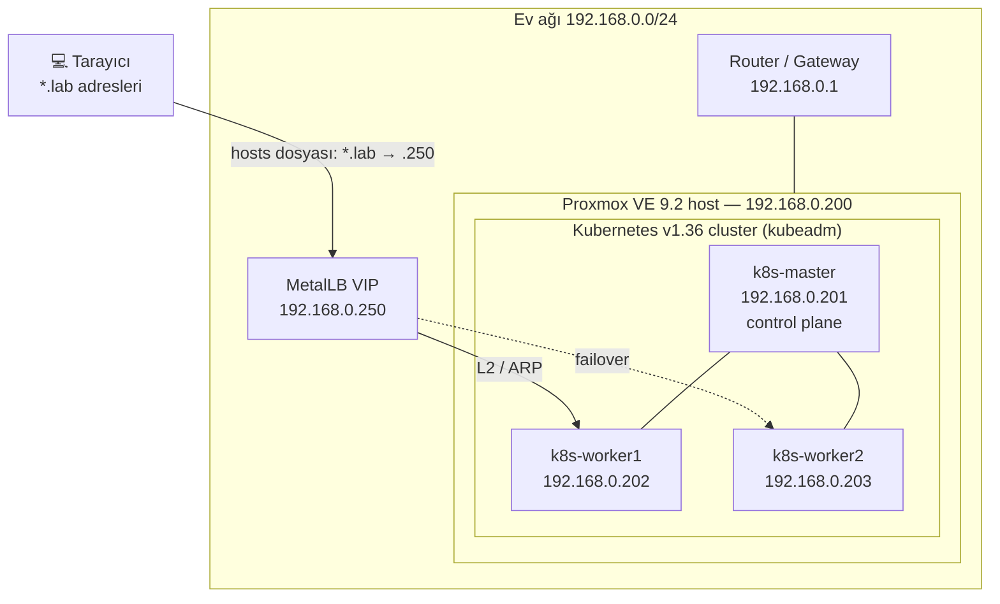
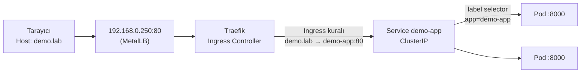

# homelab-k8s

> Eski bir laptop üzerinde sıfırdan kurulmuş, production benzeri bir Kubernetes platformu:
> bare-metal hypervisor → kubeadm cluster → yük dengeleme, ingress, depolama →
> Argo CD ile GitOps → Jenkins ile CI (test, kalite kapısı, image taraması) →
> Prometheus/Grafana ile izleme → e-postama düşen alarmlar.

🇬🇧 [English README](README.md) · 🐍 Uygulama reposu: [umuttvar/demo-app](https://github.com/umuttvar/demo-app)


---

## Öne çıkanlar

- Tek bir şablondan klonlanmış Proxmox VM'lerinde **3 node'lu vanilla Kubernetes** (kubeadm, k3s değil)
- **Elle hiçbir adım olmayan CI/CD döngüsü:** `git push` → testler → SonarCloud kalite kapısı → Kaniko build → **push'tan önce Trivy taraması** → GHCR → Jenkins image tag'ini Git'te günceller → Argo CD yeni sürümü yayına alır
- **Jenkins cluster'a hiç dokunmuyor.** Sadece Git'e yazıyor, Argo CD çekiyor (GitOps pull modeli)
- **Her şey kod olarak:** uygulamalar, dashboard'lar (`ConfigMap` + Grafana sidecar) ve alarm kuralları (`PrometheusRule`) bu repoda yaşıyor
- **Gözlemle bulunan, kodla düzeltilen sorun:** p95 gecikmesi kaba histogram kovaları yüzünden ~500 ms yerine 975 ms görünüyordu. Kodda düzelttim, pipeline'dan geçirdim ve ~740 ms olarak doğruladım
- **En az yetkili secret'lar:** her araç için ayrı token, hiçbiri Git'te değil

---

## Neden bu proje?

Bulut sağlayıcılarının normalde bizden sakladığı katmanlarda gerçek deneyim kazanmak istedim.
AWS ya da Azure'da load balancer IP'si, ingress adresi, CI çalıştırıcısı ve izleme altyapısı "hazır" gelir.
Bu homelab'de **hiçbiri yoktu**: BIOS ayarlarından gelen kutuma düşen alarma kadar her katmanı
elle kurdum, yapılandırdım ve hatalarını ayıkladım.

---

## Mimari



### Bir isteğin yolculuğu



Tek IP, tek port, birçok uygulama: Traefik her isteği HTTP `Host` başlığına göre yönlendiriyor.

### CI/CD akışı (iki repo)

```mermaid
flowchart LR
    dev["👨‍💻 git push"] --> app["demo-app reposu<br/>kod · Dockerfile · Jenkinsfile"]
    app -->|"pollSCM 5 dk"| J

    subgraph J["Jenkins (geçici agent pod'u)"]
        direction LR
        t["Test<br/>pytest + coverage"] --> s["Kalite kapısı<br/>SonarCloud"] --> b["Build<br/>Kaniko → tar"] --> v["Tarama<br/>Trivy"] --> p["Push<br/>crane → GHCR"] --> g["GitOps güncelle<br/>tag: 1.0.N"]
    end

    g -->|"commit"| ops["homelab-k8s reposu<br/>cluster'ın olması gereken hali"]
    ops -->|"Argo CD 3 dk'da bir bakar"| argo["Argo CD"]
    argo -->|"rolling update"| pods["demo-app pod'ları"]
    pods -->|"/metrics"| prom["Prometheus"] --> graf["Grafana"]
    prom --> am["Alertmanager"] --> mail["📧 E-posta"]
```



| | **demo-app** reposu | **homelab-k8s** reposu (bu repo) |
|---|---|---|
| Cevapladığı soru | *Ne* çalışacak? | *Nasıl ve nerede* çalışacak? |
| İçerik | Kaynak kod, testler, Dockerfile, Jenkinsfile | Helm chart'ları, Argo CD uygulamaları, platform ayarları |
| İzleyen | Jenkins | Argo CD |
| Çıktı | Taranmış bir container image'ı | Çalışan pod'lar |

İki repo arasındaki tek sözleşme **image tag'i**.

### Ağ planı

| Adres | Görevi |
|---|---|
| `192.168.0.1` | Router / varsayılan ağ geçidi |
| `192.168.0.2 – .249` | Router DHCP havuzu (evdeki diğer cihazlar) |
| `192.168.0.200` | Proxmox VE host |
| `192.168.0.201` | `k8s-master` (sabit) |
| `192.168.0.202` | `k8s-worker1` (sabit) |
| `192.168.0.203` | `k8s-worker2` (sabit) |
| `192.168.0.250 – .254` | MetalLB LoadBalancer havuzu (DHCP aralığının dışında) |
| `10.244.0.0/16` | Pod ağı (Flannel) |
| `10.96.0.0/12` | Service ağı (Kubernetes varsayılanı) |

---

## Kullanılan teknolojiler

| Katman | Araç | Not |
|---|---|---|
| Donanım | Eski laptop, 16 GB RAM | 7/24 sunucuya çevrildi, kapak kapanınca uyku kapatıldı |
| Hypervisor | **Proxmox VE 9.2** | Type-1 (bare-metal) hypervisor, KVM/QEMU |
| Misafir işletim sistemi | **Ubuntu Server 26.04 LTS** | Tek bir hazırlanmış şablondan klonlandı |
| Container runtime | **containerd 2.2** | `SystemdCgroup = true` |
| Kubernetes | **kubeadm ile v1.36.5** | 1 control plane + 2 worker, vanilla (k3s değil) |
| CNI | **Flannel** | Pod CIDR `10.244.0.0/16` |
| Paket yöneticisi | **Helm 4** | Kendi chart'larım + sürümü sabitlenmiş hazır chart'lar |
| Load balancer | **MetalLB 0.16** (L2 modu) | RAM tasarrufu için FRR/BGP bileşenleri kapatıldı |
| Ingress | **Traefik 3.7** | Mart 2026'da emekliye ayrılan ingress-nginx yerine seçildi |
| Depolama | **local-path-provisioner** | Varsayılan StorageClass, dinamik PV oluşturma |
| GitOps | **Argo CD 3.5** | App of Apps, `prune` + `selfHeal` ile otomatik senkronizasyon |
| CI | Kubernetes üzerinde **Jenkins 2.580** | Controller + geçici agent pod'ları (6 container) |
| Kod kalitesi | **SonarCloud** | CI tabanlı analiz, pipeline kalite kapısını bekliyor |
| Image build | **Kaniko** | Kubernetes içinde daemon'suz, yetkisiz build |
| Image taraması | **Trivy 0.75** | HIGH/CRITICAL, sadece düzeltmesi olan CVE'ler, pipeline'ı durdurur |
| Registry | **GHCR** | Image'lar `crane` ile gönderiliyor |
| İzleme | **kube-prometheus-stack** (Prometheus, Grafana, Alertmanager) | ServiceMonitor, PrometheusRule, kod olarak dashboard |
| Erişilebilirlik kontrolü | **Uptime Kuma** | Cluster içi Service DNS üzerinden kontrol |
| Uygulama | **FastAPI** (Python 3.13) | `/`, `/health`, `/slow`, `/error`, `/metrics` |

---

## Repo yapısı

```
homelab-k8s/
├── root-app.yaml               # Argo CD "App of Apps": elle uygulanan tek dosya
├── apps/                       # Her chart için bir Argo CD Application
│   ├── demo-app.yaml
│   ├── podinfo.yaml
│   ├── whoami.yaml
│   ├── it-tools.yaml
│   └── uptime-kuma.yaml
├── charts/                     # Kendi yazdığım Helm chart'ları
│   ├── demo-app/               # CI pipeline'ının build ettiği uygulama
│   │   ├── values.yaml         # image.tag her build'de Jenkins tarafından güncelleniyor
│   │   ├── dashboards/
│   │   │   └── demo-app.json   # Grafana dashboard'u (klasik JSON olarak dışa aktarıldı)
│   │   └── templates/
│   │       ├── deployment.yaml
│   │       ├── service.yaml
│   │       ├── ingress.yaml
│   │       ├── servicemonitor.yaml      # "Prometheus, beni kazı"
│   │       ├── prometheusrule.yaml      # Alarm kuralları
│   │       └── dashboard-configmap.yaml # Grafana sidecar'ı tarafından yükleniyor
│   ├── podinfo/                # Rolling update / rollback deneyleri
│   ├── whoami/                 # Durumsuz (stateless) uygulama, 3 replika
│   ├── it-tools/               # Durumsuz SPA, 3 replika
│   └── uptime-kuma/            # Durumlu (stateful) uygulama: PVC, tek replika, Recreate
├── infra/                      # Hazır platform chart'larının values dosyaları (Helm ile kuruldu)
│   ├── metallb/
│   ├── traefik/
│   ├── local-path/
│   ├── argocd/
│   ├── jenkins/
│   └── monitoring/             # kube-prometheus-stack: ingress, saklama süresi, alarm yönlendirme
└── docs/images/                # README'deki ekran görüntüleri
```

> `apps/` ve `charts/` Argo CD tarafından uygulanıyor: push = deploy.
> `infra/` platformun nasıl kurulduğunun kaydı. `helm upgrade` ile elle uygulanıyor (bkz. [Yol haritası](#yol-haritası)).

---

## Nasıl kuruldu?

### Aşama 0: Laptopu hypervisor'a çevirmek

- BIOS'ta CPU sanallaştırmasının (VT-x) açık olduğunu doğruladım.
- Windows'u silip USB'den **Proxmox VE** kurdum.
- Kapak kapanınca uyumayı systemd-logind drop-in dosyasıyla kapattım
  (`/etc/systemd/logind.conf.d/lid.conf`). Debian 13'te `/etc/systemd/logind.conf` artık varsayılan olarak gelmiyor.
- Enterprise güncelleme deposunu kapatıp no-subscription deposunu açtım ve host'u güncelledim.


### Aşama 1: Tekrar kullanılabilir bir VM şablonu

Ubuntu'yu üç kez kurmak yerine **tek** bir VM hazırlayıp klonladım:

1. Ubuntu Server'ı OpenSSH ve `qemu-guest-agent` ile kurdum.
2. Her Kubernetes node'unun ihtiyaç duyduğu ayarları yaptım:
   - swap'ı kalıcı olarak kapattım (`swapoff -a` + `/etc/fstab`)
   - `overlay`, `br_netfilter` kernel modüllerini ve gerekli `sysctl` ayarlarını ekledim
   - `SystemdCgroup = true` ile containerd
   - `pkgs.k8s.io`'dan `kubeadm`, `kubelet`, `kubectl`, `apt-mark hold` ile sabitlenmiş
3. Her klonun kendine ait bir kimliği olsun diye `/etc/machine-id`'yi sıfırladım (yoksa router tüm klonlara aynı DHCP IP'sini veriyor).
4. VM'i **Proxmox template**'ine çevirip üç **full clone** oluşturdum.
5. Her klona kendi hostname'ini, sabit IP'sini (netplan) ve `/etc/hosts` kayıtlarını verdim.

### Aşama 2: Cluster'ı ayağa kaldırmak

```bash
# k8s-master üzerinde
sudo kubeadm init \
  --apiserver-advertise-address=192.168.0.201 \
  --pod-network-cidr=10.244.0.0/16

kubectl apply -f https://github.com/flannel-io/flannel/releases/latest/download/kube-flannel.yml

# her worker üzerinde
sudo kubeadm join 192.168.0.201:6443 --token <token> --discovery-token-ca-cert-hash sha256:<hash>
```


### Aşama 3: Deployment, Service ve rolling update

Temel yapı taşlarını anlamak için ilk uygulamayı elle yazdığım YAML'larla deploy ettim:

- Deployment → Pod ← Service bağlantısını kuran **label ve selector'lar**
- **Readiness ve liveness probe** farkı
- **Resource request ve limit'ler**
- Service'in **üç portu**: `nodePort` (dışarısı), `port` (cluster içi), `targetPort` (container)
- Sürekli `curl` isteği atan bir döngüyle **kesintisiz rolling update** doğrulaması
- Bilerek bozulmuş bir sürümün (`ImagePullBackOff`) **geri alınması**. `maxUnavailable: 0` sayesinde eski sürüm tüm süre boyunca trafiğe cevap verdi
- **Configuration drift**: `kubectl rollout undo`'dan sonra neden Git'teki dosyanın da düzeltilmesi gerektiği

### Aşama 4: Cluster'ı platforma çevirmek

| Sorun | Çözüm |
|---|---|
| `type: LoadBalancer` sonsuza kadar `<pending>` kalıyor | **MetalLB** ev ağından gerçek IP dağıtıyor (L2/ARP) |
| Her uygulama için ayrı NodePort (`:30080`, `:30081` ...) | **Traefik** + Ingress kuralları: tek IP, isimle yönlendirme |
| Pod yeniden başlayınca veri kayboluyor | Varsayılan StorageClass olarak **local-path-provisioner** |


### Aşama 5: Kendi Helm chart'larımı yazmak

Düz YAML'ları bir Helm chart'ına (`values.yaml` + şablonlanmış `templates/`) çevirdim.
Sonra bu chart'ı yeni uygulamalar için başlangıç noktası olarak kullandım. Her image'ın
dokümantasyonunu okuyarak portunu, veri klasörünü ve sağlık kontrolü adresini buldum:

| Uygulama | Adres | Replika | Depolama | Not |
|---|---|---|---|---|
| demo-app | `http://demo.lab` | 2 | – | CI/CD pipeline'ı tarafından build edilip deploy ediliyor |
| podinfo | `http://podinfo.lab` | 2 | – | Rolling update / rollback laboratuvarı |
| whoami | `http://whoami.lab` | 3 | – | Pod'lar arası yük dağılımını gösteriyor |
| IT-Tools | `http://tool.lab` | 3 | – | `latest` yerine sabit image tag'i |
| Uptime Kuma | `http://uptime.lab` | **1** | **1 Gi PVC** | SQLite → tek replika + `Recreate` stratejisi |


### Aşama 6: Argo CD ile GitOps

Bu repo cluster'ın **tek doğruluk kaynağı** oldu.

- **App of Apps:** `root-app.yaml` Argo CD'ye `apps/` klasörünü gösteriyor. Oradaki her dosya, `charts/` altındaki bir chart'ı gösteren bir Application. Yeni uygulama eklemek = bir dosya eklemek.
- `prune: true` (Git'ten silinen cluster'dan da silinir) ve `selfHeal: true` (cluster'da elle yapılan değişiklikler geri alınır) ile **otomatik senkronizasyon**.
- **Var olan kurulumları devralmak:** Uygulamalar önceden Helm ile kurulmuştu. Sadece Helm release secret'larını (`sh.helm.release.v1.*`) sildim. Böylece Argo CD kaynakları yeniden oluşturmadan sahipliği devraldı.
- **Rollback = `git revert`.** `kubectl rollout undo` zaten `selfHeal` tarafından geri alınırdı. Git geçmişi aynı zamanda denetim kaydı.

Self-heal testi: `kubectl delete configmap demo-app-dashboard` → Argo CD saniyeler içinde yeniden oluşturdu → Grafana dashboard'u kendiliğinden geri geldi.


### Aşama 7: Jenkins ile CI

Jenkins **cluster'ın içinde** çalışıyor. Her build, her araç için bir container içeren
(python, sonar-scanner, kaniko, trivy, crane, git) yeni bir **agent pod'u** alıyor. Build bitince pod siliniyor:
her seferinde temiz ortam, kaynaklar sadece build sırasında kullanılıyor.

| Aşama | Araç | Neden orada? |
|---|---|---|
| Test | `pytest --cov` | En ucuz kapı en başta. `coverage.xml` üretiyor |
| Code Quality | SonarCloud | `sonar.qualitygate.wait=true` kapıyı sadece rapor değil, **engelleyici** yapıyor |
| Build | Kaniko `--no-push` | Docker daemon yok, privileged container yok. Image sadece `image.tar`'a yazılıyor |
| Security Scan | Trivy `--severity HIGH,CRITICAL --ignore-unfixed --exit-code 1` | **Shift-left:** açığı olan bir image registry'ye asla ulaşmıyor |
| Push | crane | Taranmış tar'ı GHCR'ye `1.0.<BUILD_NUMBER>` olarak gönderiyor |
| Update GitOps | git | Yeni tag'i bu repodaki `charts/demo-app/values.yaml`'a commit'liyor |

Pipeline ayarları: `timeout(20 dk)`, `disableConcurrentBuilds()` ve her agent container'ında bellek request/limit'leri.

**Trivy hikâyesi:** İlk tarama, benim kodumda hiç olmayan HIGH CVE'ler yüzünden başarısız oldu. Açıklar, çalışma
zamanı image'ında boşuna duran `pip`'in kendi içine gömülü kütüphanelerinden geliyordu. Çözüm yamamak değil,
**gereksizi atmaktı** (bağımlılıklar kurulduktan sonra `pip uninstall -y pip`): daha küçük saldırı yüzeyi.


#### Secret'lar: her iş için bir token, en az yetki

| Kimlik bilgisi | Yetkisi | Nerede duruyor |
|---|---|---|
| `ghcr-creds` | Sadece `write:packages` yetkili GitHub token'ı | `jenkins` namespace'inde Kubernetes Secret, crane container'ına bağlı |
| `github-gitops` | Fine-grained token: **sadece** `homelab-k8s`, **sadece** Contents okuma/yazma | Jenkins credential |
| `sonarcloud-token` | SonarCloud analiz token'ı | Jenkins credential (Secret text) |
| `gmail-smtp` | Gmail **uygulama şifresi** (hesap şifresi değil), iptal edilebilir | `monitoring`'de Kubernetes Secret, Alertmanager'a bağlı |

İki repo da public olmasına rağmen hiçbiri Git'te değil. Jenkins'in kubeconfig'i ve cluster yetkisi **yok**.

### Aşama 8: Prometheus ve Grafana ile izleme

3 günlük saklama süresi ve 5 Gi diskle **kube-prometheus-stack** kurdum (Prometheus Operator, Prometheus, Grafana, Alertmanager, node-exporter, kube-state-metrics).

**Uygulama nasıl kazınıyor?**

```
FastAPI + prometheus-fastapi-instrumentator  →  /metrics'i sunuyor
ServiceMonitor (demo-app chart'ında)         →  "app=demo-app label'lı Service'in 'http' portunu, /metrics yolundan, 15 sn'de bir kazı"
Prometheus Operator                          →  bunu Prometheus ayarına çeviriyor
Kubernetes Endpoints                         →  Ready pod'ların güncel IP'leri. Prometheus her pod'u doğrudan kazıyor
```

Pod'lar Service üzerinden değil, tek tek kazınıyor: yük dengeleyiciden geçmek farklı pod'ların sayaçlarını birbirine karıştırırdı.

PromQL ile yazılmış **altın sinyaller dashboard'u**:

| Panel | Sorgu |
|---|---|
| İstek/sn | `sum(rate(http_requests_total{namespace="demo-app", handler="/"}[1m]))` |
| Hata oranı | `sum(rate(...{status="5xx"}[1m])) / sum(rate(...[1m]))` |
| p95 gecikme | `histogram_quantile(0.95, sum by (le) (rate(http_request_duration_seconds_bucket{handler="/slow"}[5m])))` |

**Kod olarak dashboard:** Dashboard klasik JSON olarak `charts/demo-app/dashboards/` altına aktarıldı ve
`grafana_dashboard: "1"` label'lı bir ConfigMap'e sarıldı. Grafana'nın sidecar'ı onu otomatik yüklüyor. Artık Git'te
versiyonlu ve arayüzde "provisioned" olarak işaretli.

**Yük testi:** 20 eşzamanlı istemci (`xargs -P 20 curl`) iki pod'da **~280 istek/sn**'ye ulaştı.


#### Gözlemle bulunan sorun: yalan söyleyen p95

`/slow` 0.5 sn uyuyor, ama p95 paneli **975 ms** gösteriyordu.

- Instrumentator'ın varsayılan kovaları sadece `0.1, 0.5, 1`. 0.502 sn süren bir istek `0.5` kovasını kıl payı kaçırıp `0.5–1` kovasına düşüyor.
- `histogram_quantile` değerlerin kova içinde eşit dağıldığını varsayıyor, yani p95 = 0.5 + 0.95 × 0.5 = **0.975 sn**.
- **Kodda düzeltme:** `latency_lowr_buckets=(0.05, 0.1, 0.25, 0.5, 0.75, 1, 2.5)`.
- `demo-app`'e push → Jenkins → GHCR → Argo CD → yeni pod'lar → panel tahmin ettiğim gibi **~740 ms**'ye (0.5 + 0.95 × 0.25) indi.

Ders: Histogram ancak kovaları kadar hassastır. Kova sınırları önemsediğin eşiklere (SLO'lara) denk gelmeli.
Handler başına daha fazla kova daha fazla zaman serisi (kardinalite) demek. Kütüphanenin `handler` label'ı olmayan ayrı bir yüksek çözünürlüklü histogram tutmasının sebebi bu.

### Aşama 9: Alarmlar

**Kod olarak kural** (`charts/demo-app/templates/prometheusrule.yaml`):

```yaml
- alert: DemoAppHighErrorRate
  expr: |
    sum(rate(http_requests_total{namespace="demo-app", status="5xx"}[2m]))
    /
    sum(rate(http_requests_total{namespace="demo-app"}[2m]))
    > 0.05
  for: 2m
  labels:
    severity: warning
```

- Kural `release: monitoring` label'ını taşıyor, çünkü Operator'ın `ruleSelector`'ı sadece bu label'lı kuralları yüklüyor.
- `for: 2m` alarmı önce **pending**'de tutuyor. Kısa bir sıçrama kimseyi uyandırmıyor.
- Açıklama satırında `` {{` ... `}} `` kullanılıyor. Böylece Helm `{{ $value | humanizePercentage }}` ifadesine dokunmadan Prometheus'a iletiyor.

**Yönlendirme:** Alertmanager alarmları `alertname` + `namespace`'e göre grupluyor, **e-posta** ile gönderiyor
(şifresi bağlı bir Secret'tan okunan Gmail uygulama şifresiyle SMTP), sorun bitince **resolved** mesajı atıyor
ve `Watchdog`'u boş bir alıcıya yönlendiriyor.

Uçtan uca test edildi: ~%10 hata üretildi → inactive → pending → firing → e-posta → trafik durduruldu → resolved e-postası.


---

## Tasarım kararları

- **k3s yerine vanilla Kubernetes (kubeadm):** Şirketlerin kullandığına ve CKA sınavına daha yakın, hiçbir şey gizlenmiyor.
- **ingress-nginx yerine Traefik:** ingress-nginx Mart 2026'da emekliye ayrıldı. Traefik hem Ingress'i hem Gateway API'yi destekliyor.
- **MetalLB havuzu DHCP aralığının dışında:** Router'ın bir Service IP'sini telefona vermesini engelliyor.
- **İki repo, tek sözleşme (image tag'i):** Uygulama kodu ve cluster durumu farklı sebeplerle ve farklı hızlarda değişiyor.
- **Pull tabanlı GitOps:** CI Git'e yazıyor, Argo CD çekiyor. Ele geçirilmiş bir Jenkins cluster'a doğrudan dokunamaz.
- **Push'tan önce tarama:** Trivy yerel tar üzerinde çalışıyor. Registry'de sadece taranmış image'lar var.
- **Docker-in-Docker yerine Kaniko:** daemon yok, privileged pod yok.
- **Değişmez, benzersiz tag'ler (`1.0.<build>`)**, asla `latest`: her deployment bir build'e ve bir commit'e kadar izlenebiliyor.
- **Sabitlenmiş chart sürümleri** (`helm upgrade --version ...`): Sürümsüz bir upgrade sessizce en yeni chart'ı çeker.
- **Her container'da bellek limiti var, CPU limiti yok:** Node'da bellek bitince paylaşılamaz. CPU limiti ise çoğunlukla gereksiz yavaşlamaya (throttling) yol açıyor.
- **Durumlu uygulama = 1 replika + `Recreate`:** İki pod aynı SQLite dosyasını asla aynı anda açmamalı. Takas: yeniden başlatmalarda kısa bir kesinti, karşılığında veri bütünlüğü.
- **Dashboard'lar ve alarmlar uygulamanın yanında** (kendi chart'ında): onunla birlikte deploy ediliyor, versiyonlanıyor ve geri alınıyor.
- **`helm --set` yerine Git'teki values dosyaları:** `--set` repo ile cluster arasında sessizce sapma (drift) yaratır.
- **Uptime Kuma, Service'leri cluster DNS'i üzerinden kontrol ediyor** (`<svc>.<ns>.svc.cluster.local`): `*.lab` isimleri sadece benim bilgisayarımın hosts dosyasında var.

---

## Karşılaştığım sorunlar ve çözümleri

Gerçek hata ayıklama süreci, yaşandığı sırayla.

### Platform

| Belirti | Kök neden | Çözüm |
|---|---|---|
| Proxmox web arayüzüne erişilemiyor | Host IP'si `192.168.1.x`, router `192.168.0.x`: farklı alt ağlar | `/etc/network/interfaces`'te IP'yi `192.168.0.200/24` yaptım |
| `sed: can't read /etc/systemd/logind.conf` | Debian 13 bu dosyayı artık içermiyor | `logind.conf.d/` altında drop-in dosyası kullandım |
| `kubeadm init`: `[ERROR Mem] ... 1642 MB` | VM'ler varsayılan 2 GB RAM ile oluşturulmuş | Tüm node'ları 4 GB'a çıkardım |
| Worker'lar `Waiting for a healthy kubelet` aşamasında takıldı | Swap hâlâ açıktı: `fstab` satırı tab içeriyordu, `sed` kalıbım boşluk bekliyordu | Boşluk türünden bağımsız bir kalıpla swap satırını kapattım, `kubeadm reset`, tekrar join |
| MetalLB 5 container'lık `frr-k8s` pod'ları kurdu | Yeni chart sürümleri BGP bileşenini varsayılan olarak açıyor | `helm show values` ile `frrk8s.enabled`'ı buldum, values dosyasıyla kapattım |
| `strict decoding error: unknown field` | Alan adlarında yazım hataları (`ipAdressPools`, `accessMode`, `mounthPath`) | Hata mesajını okudum, Kubernetes hatalı alanın adını tam olarak söylüyor |
| Ingress oluşmadı, hata da yok | `ingress.yaml`'ı `templates/`'in içine değil yanına koymuşum | Helm sadece `templates/` içindeki dosyaları işliyor |
| `volumes` reddedildi / probe'lar kayboldu | `volumes:` container bloğunun içine girintilenmişti | `containers:` ile kardeş olacak şekilde Pod seviyesine taşıdım |
| Sağlık adresi olmayan bir uygulamada `/health` probe'u geçiyor | SPA her adres için `index.html` (200) dönüyor | Niyet açıkça belli olsun diye probe'u `/` yaptım |
| Host ve VM'ler birkaç saatte bir ağdan düşüyor | Realtek `r8169` ağ kartında bağlantı kopmaları (`Link is Down`), Energy-Efficient Ethernet tetikliyor | Kablo/port değişikliği, `vmbr0`'a `post-up` olarak `ethtool --set-eee nic0 eee off` |
| `worker2` **NotReady**, toplu pod tahliyesi | local-path PV'leri yüzünden ağır pod'lar ona çivilenmişti (Jenkins, Prometheus, Uptime Kuma). Üstüne **request'siz** 6 container'lık build pod'u geldi, scheduler node'u boş sandı | Her agent container'ına request/limit ekledim. Node'a bağlı depolamanın pod'ları node'a çivilediğini öğrendim |
| Pod'lar `Pending`, node'da `DiskPressure` | Ubuntu kurulumu 30 GB'ın sadece 15 GB'ını root LV'ye ayırmıştı | Her node'da `lvextend -r -l +100%FREE`, çalışırken, reboot'suz |
| `default`'ta `failed` durumda eski bir `monitoring` release'i | Daha önce `-n monitoring` olmadan yapılmış bir kurulum denemesi | `helm uninstall` **değil**, sadece Helm kaydını ve namespace'e ait kalıntıları sildim. Uninstall, çalışan release'le paylaşılan cluster geneli RBAC'ı da silebilirdi |

### CI/CD

| Belirti | Kök neden | Çözüm |
|---|---|---|
| SonarCloud `403` | Token yerine **project key**'i vermişim | Gerçek bir analiz token'ı oluşturup Jenkins secret'ı olarak sakladım |
| Kaniko: Docker Hub'dan `UNAUTHORIZED` | Yetki sorunu değil: `FROM` satırında `python:` image adı eksikti | Hatadaki image adresini tamamen okudum |
| Trivy HIGH CVE'lerde başarısız | Çalışma zamanı image'ındaki `pip`'in içine gömülü kütüphaneler | Dockerfile'da `pip uninstall -y pip` |
| `git push` reddedildi | Jenkins bu arada yeni bir tag commit'lemişti | Her push'tan önce `git pull --rebase` (önce commit ya da stash) |
| Jenkins init container'ı `CrashLoopBackOff` | Önceki denemeden `emptyDir`'de kalan dosyalar | Temiz bir volume için pod'u sildim |
| Build sonsuza kadar agent bekliyor | Agent pod'u bir ağ kopmasında bağlantıyı kaybetmişti | Build'i iptal ettim, `timeout(20 dk)` ekledim |
| sonar-scanner'da `java.lang.OutOfMemoryError: Java heap space` | 1 Gi bellek limiti ekleyince JVM varsayılan olarak bunun %25'ini (~256 MB heap) aldı | `SONAR_SCANNER_JAVA_OPTS=-XX:MaxRAMPercentage=75` |
| `stat image.tar: no such file` | Push'tan "Restart from stage" yaptım: workspace'i boş **yeni** bir agent pod'u açılıyor | Pipeline'ı baştan çalıştırdım. Hızlı hata için Build'in sonuna `ls -lh image.tar` ekledim |
| Tek Deployment için birçok ReplicaSet | Her rollout bir tane bırakıyor, rollback için saklanıyor (`revisionHistoryLimit` varsayılanı 10) | Beklenen davranış. GitOps'ta rollback zaten `git revert` |

### Gözlemlenebilirlik

| Belirti | Kök neden | Çözüm |
|---|---|---|
| demo-app Prometheus target'larında yok | ServiceMonitor yoktu, Service'in de label'ı ve port adı yoktu | `metadata.labels`, `name: http`, `targetPort: 8000` ve bir ServiceMonitor ekledim |
| 500 ms'lik endpoint için p95 = 975 ms | Kaba varsayılan histogram kovaları | Kodda daha ince kovalar, pipeline ile yayına alındı (bkz. Aşama 8) |
| Dışa aktarılan dashboard sidecar tarafından yüklenmedi | Grafana 12 yeni `dashboard.grafana.app/v2` kaynak formatında dışa aktarmıştı | **Klasik** JSON olarak tekrar dışa aktardım |
| "Provisioned dashboard cannot be deleted" | Git'ten gelen dashboard, aynı UID'li arayüzdekini sahiplenmişti | Beklenen durum: sahibi artık Git. Testi ConfigMap'i silerek yaptım |
| Discord bildirimleri: `connection reset by peer` | Discord ülkemde servis sağlayıcı tarafından erişime kapalı. Ayarlar doğruydu | Alıcıyı e-postaya çevirdim. Ders: **Alarm kanalı da bir bağımlılık** |
| Yük testleri SSH oturumumu dondurdu | 20 paralel curl tek bir laptop'u doyurdu | Aynı hata *oranını* hafif, sıralı bir döngüyle ürettim. Uzun komutları Proxmox shell'inden çalıştırdım |

En önemli ders: **Tehlikeli hatalar sessiz olanlar.** Label'daki bir yazım hatası, eksik bir port adı,
hiç var olmayan bir ServiceMonitor ya da doğru label'ı taşımayan bir kural hiçbir hata mesajı üretmiyor.
Zinciri isimler üzerinden takip etmek (Ingress → Service → Endpoints → Pod, ServiceMonitor → Service, kural → selector)
ve `helm template` çıktısını okumak bu hataları yakalıyor.

---

## Bilinen sınırlar (production'da ne yapılırdı?)

| Burada | Production'da |
|---|---|
| Tek ortam | dev → staging → prod, promotion ile |
| Jenkins Git'e 5 dakikada bir bakıyor | Webhook'lar |
| Secret'lar `kubectl` ile elle oluşturuldu | Sealed Secrets / External Secrets Operator |
| Image'lar imzalı değil | cosign ile imzalama + admission politikası |
| Tek control-plane node'u | 3 control-plane node'u (HA etcd) |
| Yedek yok | Velero |
| `infra/` elle `helm upgrade` ile uygulanıyor | Platform bileşenleri de Argo CD ile yönetilir |
| VM'ler elle oluşturuldu | Terraform + Ansible |

---

## Yol haritası

- [x] Bare metal üzerinde Proxmox hypervisor
- [x] VM şablonundan 3 node'lu kubeadm cluster
- [x] MetalLB + Traefik + local-path depolama
- [x] 5 uygulama için kendi yazdığım Helm chart'ları
- [x] Argo CD ile GitOps (App of Apps, prune + self-heal)
- [x] Jenkins ile CI: test → SonarCloud → Kaniko → Trivy → GHCR → GitOps commit'i
- [x] Prometheus + Grafana ile izleme, kod olarak dashboard
- [x] Alarmlar: PrometheusRule → Alertmanager → e-posta
- [ ] `infra/`'yı da Argo CD ile yönetmek
- [ ] cert-manager ile TLS
- [ ] Sealed Secrets
- [ ] Her şeyi Terraform (Proxmox provider) + Ansible ile yeniden kurmak

---

## Tekrar kurmak için

```bash
# Platform bileşenleri
helm repo add metallb https://metallb.github.io/metallb
helm repo add traefik https://traefik.github.io/charts
helm repo add argo https://argoproj.github.io/argo-helm
helm repo add jenkins https://charts.jenkins.io
helm repo add prometheus-community https://prometheus-community.github.io/helm-charts
helm repo update

helm upgrade --install metallb metallb/metallb -n metallb-system --create-namespace --version 0.16.1 -f infra/metallb/values.yaml
kubectl apply -f infra/metallb/config.yaml
helm upgrade --install traefik traefik/traefik -n traefik --create-namespace --version 41.6.0 -f infra/traefik/values.yaml
kubectl apply -f infra/local-path/local-path-storage.yaml

# Secret'lar (asla Git'e girmez)
kubectl create namespace monitoring
kubectl create secret generic gmail-smtp -n monitoring --from-literal=password='<gmail uygulama şifresi>'

helm upgrade --install monitoring prometheus-community/kube-prometheus-stack -n monitoring --version 92.0.0 -f infra/monitoring/values.yaml
helm upgrade --install argocd argo/argo-cd -n argocd --create-namespace --version 10.9.4 -f infra/argocd/values.yaml
helm upgrade --install jenkins jenkins/jenkins -n jenkins --create-namespace --version 5.9.66 -f infra/jenkins/values.yaml

# Uygulamalar: tek komut, gerisini Argo CD yapıyor
kubectl apply -f root-app.yaml
```

Son olarak hosts dosyanda `*.lab` isimlerini (`demo`, `podinfo`, `whoami`, `tool`, `uptime`, `argocd`, `jenkins`, `grafana`, `prometheus`) `192.168.0.250`'ye yönlendir.
